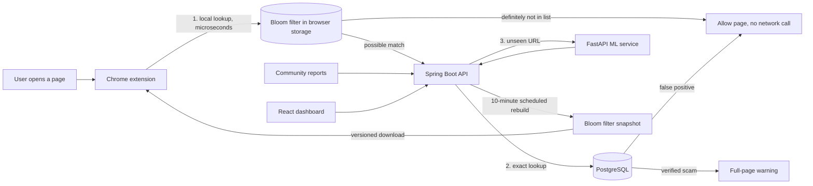

# 🛡️ Scam Link Shield


**Community-verified scam link detection with a Chrome extension that checks every page locally using a Bloom filter, plus an ML model for brand-new scams.**


## The problem

Scam links ("Your SBI KYC has expired, click here", fake job fees, UPI refund traps) spread daily over WhatsApp, SMS and email. Most people can't tell them apart before clicking. A plain "look up the URL in a database" approach has three problems:

1. **Speed:** a network call for every page you visit.
2. **Privacy:** it sends your browsing history to a server.
3. **Scale:** memory and lookup costs grow with the list.

Scam Link Shield checks a compact copy of the scam list **inside the browser**, and only contacts the server when there is a possible match.

## How it works



**Three layers of defence**

1. **Bloom filter (local):** known scams, checked in the browser with no network call.
2. **Exact database confirmation:** removes the Bloom filter's false positives.
3. **ML model:** scores URLs that have never been reported. It only adds warnings and never overrides the verified list.

A verdict of `UNKNOWN` never means "safe".

## Features

- **Community reporting and verification:** a link becomes verified after 3 independent confirmations (one per user) or an admin approval.
- **URL normalization:** `https://WWW.Scam.XYZ/login/?utm_source=wa` and `scam.xyz/login` match as the same link.
- **Chrome extension (Manifest V3):** local check, full-page warning with "proceed anyway", login popup, right-click "Report as scam".
- **React dashboard:** live link checker, statistics, report form, "my reports", admin approval panel.
- **ML scoring:** gradient-boosted model on 22 URL features, behind a FastAPI service with a timeout fallback.
- **JWT auth with roles** (USER, ADMIN) and BCrypt password hashing.


## Benchmark: Bloom filter vs HashSet vs PostgreSQL

Run with `.\mvnw.cmd test -Dtest=BloomBenchmark` (raw results in [`benchmark/results.csv`](benchmark/results.csv)). Local PostgreSQL 16, indexed primary key, 500k lookups per structure (2k for the database), 50% known and 50% unknown URLs.

| | 100k URLs | 1M URLs |
|---|---|---|
| Bloom filter size | 0.12 MB | 1.20 MB |
| Raw URL strings | 4.37 MB | 45.75 MB |
| **Memory saving** | **36.5x** | **38.2x** |
| Bloom lookup | 202 ns | 320 ns |
| HashSet lookup | 103 ns | 68 ns |
| PostgreSQL lookup | 861 µs | 711 µs |
| **Bloom vs PostgreSQL** | **~4,300x faster** | **~2,200x faster** |
| False-positive rate (theory / measured) | 1.00% / 1.02% | 1.00% / 1.00% |

**Reading these honestly**

- A plain in-memory `HashSet` is *faster* than the Bloom filter. Speed is not the Bloom filter's advantage over it.
- Its advantage is **size**: about 10 bits per URL regardless of URL length, so the whole list ships to every browser and lookups need no server.
- The database numbers are on `localhost`. A real API call over the internet would add network latency on top.
- The measured false-positive rate matches theory, which validates the sizing math.

## ML results

- **Data:** about 501k labelled URLs (21.6% phishing), plus hand-written Indian-style scam examples.
- **Split by host, not randomly,** so the same domain never appears in both train and test. Random splits leak and inflate scores.
- **Model:** `HistGradientBoostingClassifier` on 22 features (lengths, entropy, digit runs, suspicious keywords, risky TLDs, brand look-alikes).
- **ROC-AUC: 0.889** on the host-grouped test set.

| Threshold | Precision | Recall | False-positive rate |
|---|---|---|---|
| 0.5 | 0.527 | 0.798 | 19.5% |
| 0.7 | 0.694 | 0.658 | 7.9% |
| 0.8 | 0.810 | 0.568 | 3.6% |
| **0.9 (HIGH_RISK)** | **0.930** | **0.450** | **0.93%** |
| 0.95 | 0.967 | 0.336 | 0.31% |

False alarms on safe sites hurt trust more than misses, so the service only reports `HIGH_RISK` at ≥ 0.9 and `SUSPICIOUS` at 0.7 to 0.9. Recall is modest by design: the ML layer is a second line of defence, and the community-verified list stays the source of truth.

## Design decisions

- **Same normalizer in Java and JavaScript.** The filter stores normalized URLs, so the extension must normalize identically. Both implementations share the same test cases.
- **Own Bloom filter implementation** (FNV-1a with double hashing) so the JavaScript side reads the Java-built bit array exactly. A cross-language test downloads the real filter from the backend and checks the JavaScript lookups. Java's `BitSet` trims trailing zero bytes, which the JS reader handles.
- **Versioned filter downloads.** The extension polls a tiny version endpoint and downloads the filter only when its content hash changes.
- **Graceful degradation.** If the ML service is down or slow, `/api/check` falls back to `UNKNOWN` within the timeout instead of failing.
- **Generic login errors** so the API doesn't reveal which emails are registered.
- **Scam links are never rendered as clickable** in the dashboard.

## Run it

Requirements: Docker Desktop.

```bash
git clone https://github.com/srushtiubale05/scam-link-shield.git
cd scam-link-shield
docker compose up --build -d
```

| Service | URL |
|---|---|
| Dashboard | http://localhost:3000 |
| API health | http://localhost:8080/health |
| ML service docs | http://localhost:8000/docs |

**Create an admin:** register in the dashboard, then promote the account:

```bash
docker exec -it scamshield-db psql -U scam -d scamshield -c "update users set role='ADMIN' where email='you@example.com';"
```

Log out and back in so the new role is in your token.

**Load the extension (no store needed):**

1. Open `chrome://extensions` and enable **Developer mode**.
2. Click **Load unpacked** and select the `extension/` folder.
3. Pin it from the puzzle-piece menu and log in from the popup.

## Tests

```bash
cd backend && ./mvnw test -Dtest='UrlNormalizerTest,BloomFilterTest,ReportServiceTest'
cd extension && npm test
```

CI runs the Java unit tests, the extension tests, the dashboard build and an ML scoring smoke test on every push.

## Retraining the model

`ml-service/model.joblib` is committed (486 KB). To retrain, put the Kaggle "Phishing Site URLs" CSV at `ml-service/data/urls.csv` and run `python train.py`.

## Limitations and future work

- **The filter holds exact normalized URLs,** so a verified scam on a different path of the same domain isn't matched. Domain-level entries are the next step.
- **On a possible match the extension sends the full URL to the backend.** A privacy upgrade is to send only a hash prefix, as Chrome Safe Browsing does.
- **ML recall is modest (45% at the HIGH_RISK threshold)** and the training data has dataset-specific quirks. Character n-gram features would be a cheap improvement.
- **Development defaults:** the JWT secret and database password are demo values, and Hibernate uses `ddl-auto=update` instead of migrations (Flyway is the next step). Rotate secrets before any real deployment.
- **Extension points at `localhost:8080`;** it isn't published to a store.
- Abuse protection (rate limiting, reporter reputation weighting) is not implemented yet.

## Tech stack

Java 21, Spring Boot 4, Spring Security (JWT), JPA/Hibernate, PostgreSQL 16, Python 3.10, FastAPI, scikit-learn, React (Vite), Recharts, Chrome Extension (Manifest V3), Docker Compose, GitHub Actions.
